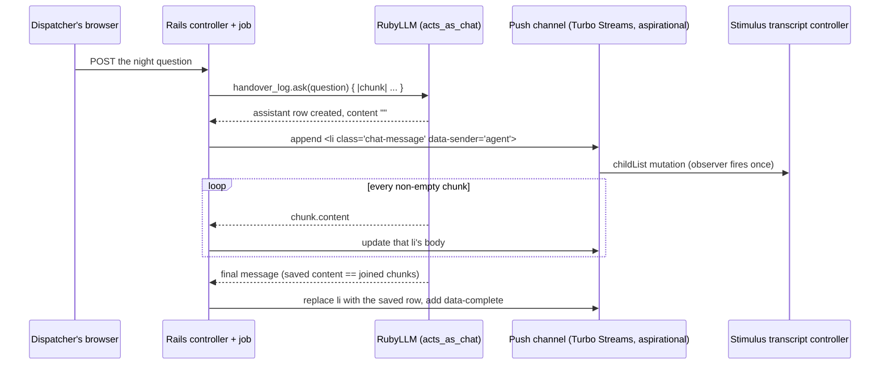

# Stimulus + RubyLLM: a streamed answer in a Stimulus transcript

**Combines:** RubyLLM (streaming, Rails integration) and Stimulus (lifecycle callbacks, dispatching events).

## When to combine

Use this pairing when a Rails page shows a chat that an LLM answers word by
word, and the browser side needs behavior the server can't give it:
following the latest line, counting unread lines, giving the tab title back
when the panel goes away. RubyLLM owns the conversation and the database
rows. Stimulus owns the reader's scroll position and the tab title.
Neither knows the other exists. They meet in the DOM.

## Source scenarios

| Library | Scenario | What it brings |
| --- | --- | --- |
| RubyLLM | [Streaming · 12 · Rio Carnival bloco broadcast](https://github.com/MICharisma/rubyllm-multivitamin/tree/main/features/02-streaming/12-rio-bloco-broadcast) | Each non-empty chunk is broadcast to every subscriber. Plain Ruby, shaped so Rails can wrap it. |
| RubyLLM | [Rails integration · 04 · Kumasi fontomfrom stream](https://github.com/MICharisma/rubyllm-multivitamin/tree/main/features/10-rails-integration/04-kumasi-fontomfrom-stream) | A streamed `ask` on an `acts_as_chat` record creates the assistant row, with empty content, before the first chunk. |
| RubyLLM | [Rails integration · 12 · Antofagasta furnace cancel](https://github.com/MICharisma/rubyllm-multivitamin/tree/main/features/10-rails-integration/12-antofagasta-furnace-cancel) | `cancel` raises `CancelledError` and destroys the blank assistant row. |
| Stimulus | [Lifecycle callbacks · 08 · Live support chat transcript](https://github.com/MICharisma/stimulus-multivitamin/tree/main/features/02-lifecycle-callbacks/08-live-support-chat-transcript) | A `MutationObserver` over a message list the controller doesn't own. `chat_stream.js` stands in for "a server push channel, such as Turbo Streams". |
| Stimulus | [Dispatching events · 04 · Lopez freight bell](https://github.com/MICharisma/stimulus-multivitamin/tree/main/features/13-dispatching-events/04-lopez-freight-bell) | `this.dispatch` with `target:` and `bubbles:`, for telling the rest of the page that a reply finished. |

## Architecture



## The seams

1. **The DOM contract.** The Stimulus transcript reacts to
   `li.chat-message` elements appended to its `messageList` target, and reads
   `data-sender`. Whatever the server pushes must keep that shape. This is
   the only thing the two libraries share.
2. **Row first, chunks second.** RubyLLM creates the assistant row before
   the first chunk (Kumasi, slot 04). Render the empty `li` from that row, so
   the observer sees exactly one append per reply instead of one per chunk.
3. **Saved content equals the join.** The saved assistant content matches
   the joined chunks (Kumasi asserts `result.speech == result.saved_content`).
   That's what lets the last push replace the streamed `li` with the
   persisted one without a visible jump.
4. **Cancel removes the row.** `cancel` destroys the blank assistant row
   (Antofagasta, slot 12). The push channel must remove the matching `li`
   too, or the transcript counts an unread message that no longer exists.

## Worked scenario: Warsaw tram depot night handover

The night dispatcher at the Tramwaje Warszawskie depot on Żoliborz,
Agnieszka Wrona, asks the handover assistant to summarise the 23:40 board
for the morning crew: two Pesa Jazz Duo sets out of service, a points heater
fault on Plac Wilsona, and line 6 diverted until 04:30. The answer streams
into a docked transcript panel. Halfway through, she pops the panel out to
read the yard map, which moves the element and reconnects the controller.
(The Warsaw depot is a recurring place; see
[Chat basics · 13 · Warsaw tram depot handover](https://github.com/MICharisma/rubyllm-multivitamin/tree/main/features/01-chat-basics/13-warsaw-tram-depot-handover).)

### Ruby: stream into the row, push each piece

> Supplement glue, not code from either repo. The RubyLLM calls
> (`acts_as_chat`, `ask` with a block, `chunk.content`, `with_instructions`,
> `to_llm.before_message`) are the ones the Kumasi scenario uses. The
> `broadcast_*_to` calls come from turbo-rails, which neither repo depends
> on. Check them against turbo-rails before relying on them.

```ruby
class HandoverLog < ApplicationRecord
  acts_as_chat messages: :handover_entries, message_class: "HandoverEntry"
end

class HandoverAnswerJob < ApplicationJob
  def perform(handover_log_id, question)
    log = HandoverLog.find(handover_log_id)
    log.with_instructions(<<~TEXT.strip)
      You are the night clerk at the Żoliborz tram depot in Warsaw.
      Summarise the board for the 05:00 crew in three short sentences.
      Name every out-of-service set by its fleet number.
    TEXT

    # The assistant row exists, empty, before the first chunk arrives.
    log.to_llm.before_message do
      entry = log.handover_entries.where(role: "assistant").order(:id).last
      Turbo::StreamsChannel.broadcast_append_to(
        log, target: "handover_messages",
        partial: "handover_entries/entry", locals: { entry: entry }
      )
    end

    spoken = +""
    log.ask(question) do |chunk|
      piece = chunk.content.to_s
      next if piece.empty?            # Rio, slot 12: empty chunks are not broadcast

      spoken << piece
      Turbo::StreamsChannel.broadcast_update_to(
        log, target: "handover_entry_body_last",
        partial: "handover_entries/body", locals: { text: spoken }
      )
    end
  end
end
```

### JavaScript: hear the reply finish

The transcript controller in Lifecycle callbacks · 08 already scrolls or
counts unread lines on `childList` mutations. This small companion
controller tells the rest of the page when a reply is finished, using the
`dispatch` options from Dispatching events · 04.

```js
// handover_reply_controller.js — registered as "handover-reply"
// Supplement glue. Stimulus APIs as used in the stimulus-multivitamin repo.
import { Controller } from "@hotwired/stimulus"

export default class extends Controller {
  static values = { complete: Boolean, fleetNumbers: Array }

  completeValueChanged(isComplete) {
    if (!isComplete) return
    this.dispatch("finished", {
      target: document,
      detail: { fleetNumbers: this.fleetNumbersValue, at: new Date().toISOString() }
    })
  }
}
```

```html
<li class="chat-message from-agent" data-sender="agent"
    data-controller="handover-reply"
    data-handover-reply-complete-value="false"
    data-handover-reply-fleet-numbers-value='["3101","3114"]'>
  <span class="chat-byline">Depot clerk · 23:41</span>
  <p id="handover_entry_body_last"></p>
</li>
```

## Pitfalls

- **The observer only hears appends.** The Stimulus transcript observes
  `{ childList: true }` on the message list. Updating the text inside an
  existing `li` is not a `childList` change, so streamed text never moves
  the scroll position. Either scroll on the final replace, or add a second
  observer with `characterData` and `subtree` and throttle it.
- **Moving the panel mid-stream.** Popping the panel out disconnects and
  reconnects the transcript controller (that's the lesson of slot 08). Any
  push that looks its target up by id each time, as `chat_stream.js` does,
  keeps working. A push that cached the element writes into a detached node.
- **One fixed target id.** `handover_entry_body_last` is fine for one reply
  at a time. If two dispatchers ask at once, give each assistant row its own
  id.
- **Don't run tools from chunks.** `chunk.tool_calls` can hold a partial
  argument string (Streaming README). Wait for the completed call.
- **Cancellation is a different error.** `RubyLLM::CancelledError` inherits
  `StandardError`, not `RubyLLM::Error`, so a `rescue RubyLLM::Error` in the
  job won't catch it.
