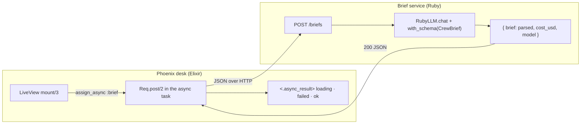

# Phoenix + RubyLLM: a LiveView that asks a RubyLLM service

**Combines:** Phoenix (async assigns, controllers and JSON) and RubyLLM (structured output, tokens and cost).

## When to combine

Use this when the operations desk is a Phoenix app, but the team's LLM
prompts, schemas, and recorded cassettes already live in Ruby. Rather than
porting them, put RubyLLM behind a small HTTP endpoint and let LiveView
call it without blocking the page. Phoenix owns the desk, the socket, and
the loading state. RubyLLM owns the prompt, the schema, and the model.

If you'd rather stay in one runtime, the Elixir side would need its own LLM
client. Nothing in the Phoenix multivitamin covers that yet, so this guide
doesn't pretend to.

## Source scenarios

| Library | Scenario | What it brings |
| --- | --- | --- |
| Phoenix | [Async assigns · 01 · Puerto Natales wind fetch](https://github.com/MICharisma/phoenix-multivitamin/tree/main/features/08-async-assigns/01-puerto-natales-wind-fetch) | `assign_async/3` from mount runs only once the socket connects; `<.async_result>` renders loading, failed, and the value. |
| Phoenix | [Async assigns · 12 · Walvis Bay timeout](https://github.com/MICharisma/phoenix-multivitamin/tree/main/features/08-async-assigns/12-walvis-bay-timeout) | The failed reason is exactly the `{:error, reason}` the function returned. |
| Phoenix | [Async assigns · 13 · Balmaceda capstone desk](https://github.com/MICharisma/phoenix-multivitamin/tree/main/features/08-async-assigns/13-balmaceda-capstone-desk) | One assign can succeed while another stays failed until a retry. |
| RubyLLM | [Structured output · 01 · Ubud subak board](https://github.com/MICharisma/rubyllm-multivitamin/tree/main/features/04-structured-output/01-ubud-subak-board) | `with_schema` on a `Schematist::Schema` subclass; `response.content` stays JSON text and `response.parsed` is a Hash with string keys. |
| RubyLLM | [Tokens and cost · 01 · Pokhara Sarangkot tokens](https://github.com/MICharisma/rubyllm-multivitamin/tree/main/features/12-tokens-and-cost/01-pokhara-sarangkot-tokens) | `response.tokens` and `response.cost`, for returning a cost alongside the answer. |

## Architecture



## The seams

1. **The schema is the contract.** The Schematist class on the Ruby side
   decides the JSON keys. `response.parsed` has **string** keys and numbers
   arrive as numbers (Ubud, slot 01). On the Elixir side, decoded JSON also
   has string keys. Match on `"wind_component_kt"`, not `:wind_component_kt`.
2. **The async function's return value is the failure.** Return
   `{:error, reason}` with a reason the template can name (Walvis Bay, slot
   12). Don't raise inside the task for an expected 422 from the service.
3. **Dead render does nothing.** `assign_async` doesn't start on the
   disconnected render (Puerto Natales test: "assign_async does not start on
   the dead render"). So the HTTP call, and its cost, happens once per
   connected desk, not twice.

## Worked scenario: Puerto Natales crosswind brief

Esperanza, the clerk at Teniente Julio Gallardo aerodrome in Puerto Natales,
has the Pilatus PC-6 crew waiting. The desk already fetches the raw wind,
`32022G34KT` (Puerto Natales, slot 01). Now she wants a crew brief: the
crosswind component for runway 28, whether the gust spread exceeds the
company's 12-knot limit, and one sentence for the pilot, Joaquín Pairicán.
The Ruby service answers with JSON. The desk shows it, or names the failure.

### Ruby: the brief service

> Supplement glue. `RubyLLM.chat`, `with_instructions`, `with_temperature`,
> `with_schema`, `parsed`, `tokens`, `cost.total`, and `Schematist::Schema`
> are as used in the RubyLLM multivitamin. The Rack wrapper is ordinary
> Ruby. The RubyLLM repo's Rails scenarios boot ActiveRecord only, not a full
> Rails app, so a production service would likely be a Rails controller.

```ruby
require "json"
require "ruby_llm"

class CrewBrief < Schematist::Schema
  title "crew_brief"
  description "Crosswind brief for one runway at one aerodrome"

  string :runway, description: "Runway designator, e.g. 28"
  number :crosswind_kt, description: "Crosswind component in knots, as a number"
  number :gust_spread_kt, description: "Gust minus mean wind in knots"
  boolean :over_company_limit, description: "True when gust spread exceeds 12 kt"
  string :pilot_sentence, description: "One sentence for the pilot, by name"
end

BriefService = lambda do |env|
  request = JSON.parse(env["rack.input"].read)
  chat = RubyLLM.chat
  chat.with_instructions("You are the briefing clerk at Puerto Natales. Use only the wind given.")
  chat.with_temperature(0.2)
  chat.with_schema(CrewBrief)

  answer = chat.ask(<<~TEXT)
    Wind #{request.fetch("wind")}, runway #{request.fetch("runway")}, pilot #{request.fetch("pilot")}.
  TEXT

  body = { brief: answer.parsed, cost_usd: answer.cost.total, model: answer.model }
  [200, { "content-type" => "application/json" }, [JSON.generate(body)]]
rescue KeyError => missing
  [422, { "content-type" => "application/json" }, [JSON.generate(error: missing.key)]]
end
```

### Elixir: the LiveView

> Supplement glue. `assign_async/3`, `<.async_result>`, and the
> `{:ok, map}` / `{:error, reason}` contract are as used in the Phoenix
> multivitamin. `Req` is a dependency in its `mix.exs`, but no scenario
> calls it yet, so the `Req.post/2` options here are worth checking against
> Req's docs.

```elixir
defmodule PhoenixMultivitaminWeb.PuertoNatalesCrewBriefLive do
  use PhoenixMultivitaminWeb, :live_view

  @brief_service "http://localhost:9292/briefs"

  @impl true
  def mount(_params, _session, socket) do
    request = %{wind: "32022G34KT", runway: "28", pilot: "Joaquín Pairicán"}

    {:ok,
     socket
     |> assign(:page_title, "Puerto Natales crew brief")
     |> assign_async(:brief, fn -> fetch_brief(request) end)}
  end

  defp fetch_brief(request) do
    case Req.post(@brief_service, json: request, receive_timeout: 30_000) do
      {:ok, %Req.Response{status: 200, body: %{"brief" => brief}}} ->
        {:ok, %{brief: brief}}

      {:ok, %Req.Response{status: 422, body: %{"error" => field}}} ->
        {:error, {:missing_field, field}}

      {:error, exception} ->
        {:error, {:service_down, Exception.message(exception)}}
    end
  end

  @impl true
  def render(assigns) do
    ~H"""
    <.async_result :let={brief} assign={@brief}>
      <:loading><p>Asking the briefing clerk…</p></:loading>
      <:failed :let={failure}><p id="brief-failed">No brief: {inspect(failure)}</p></:failed>
      <dl id="crew-brief">
        <dt>Runway</dt><dd>{brief["runway"]}</dd>
        <dt>Crosswind</dt><dd>{brief["crosswind_kt"]} kt</dd>
        <dt :if={brief["over_company_limit"]}>Gust spread over the 12 kt limit</dt>
      </dl>
      <p>{brief["pilot_sentence"]}</p>
    </.async_result>
    """
  end
end
```

## Pitfalls

- **String keys both ways.** `parsed` is a Hash with string keys on the
  Ruby side, and Jason decodes to string keys on the Elixir side. Atom keys
  in the template silently render nothing.
- **Timeouts are yours to name.** The Ruby service may take tens of
  seconds (the RubyLLM scenarios configure `timeout: 180`). Pick a receive
  timeout on the Elixir side and turn it into a named `{:error, ...}`, the
  way Walvis Bay names `:sounding_timeout`.
- **Numbers arrive as numbers, but not always integers.** `crosswind_kt`
  may decode as `14` or `14.2`. Format it before showing it.
- **Retry is a new assign.** A failed `assign_async` stays failed until you
  start it again (Balmaceda, slot 13). Add a retry button that calls
  `assign_async(:brief, ...)` from `handle_event`.
- **Cost belongs in a log.** `cost_usd` is useful for the desk supervisor,
  not the crew. Keep it out of the rendered brief.
