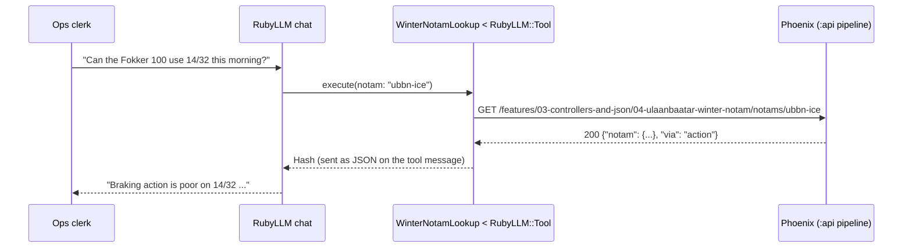

# RubyLLM + Phoenix: a RubyLLM tool that reads a Phoenix JSON endpoint

**Combines:** RubyLLM (tools) and Phoenix (controllers and JSON).

## When to combine

This is guide 02 in the other direction. Phoenix is the system of record:
it already serves NOTAMs and METARs as JSON. A Ruby assistant needs to
answer questions about them. Give the assistant a `RubyLLM::Tool` whose
`execute` makes the HTTP call, and let the model decide when to look.
Phoenix doesn't change at all. That's the appeal.

## Source scenarios

| Library | Scenario | What it brings |
| --- | --- | --- |
| Phoenix | [Controllers and JSON · 04 · Ulaanbaatar winter NOTAM](https://github.com/MICharisma/phoenix-multivitamin/tree/main/features/03-controllers-and-json/04-ulaanbaatar-winter-notam) | `json/2` for a hit; `action_fallback` turns `{:error, :not_found}` into a 404 with `{"error": "notam_missing", "via": "fallback"}`. |
| Phoenix | [Controllers and JSON · 01 · Queenstown METAR desk](https://github.com/MICharisma/phoenix-multivitamin/tree/main/features/03-controllers-and-json/01-queenstown-metar-desk) | One controller serves HTML through `render/3` and JSON through `json/2` (`/metar/export`). |
| RubyLLM | [Tools · 09 · Hallstatt salt face](https://github.com/MICharisma/rubyllm-multivitamin/tree/main/features/03-tools/09-hallstatt-salt-face) | `parameter :station, type: :string, required: true` and a keyword `execute(station:)`. |
| RubyLLM | [Tools · 07 · Bogotá emerald parcel](https://github.com/MICharisma/rubyllm-multivitamin/tree/main/features/03-tools/07-bogota-emerald-parcel) | A miss returns `{ error: }` as JSON, and the model calls the tool again. |
| RubyLLM | [Tools · 08 · Petra tomb hygrometer](https://github.com/MICharisma/rubyllm-multivitamin/tree/main/features/03-tools/08-petra-tomb-hygrometer) | A raise inside `execute` leaves `ask` and doesn't append a `:tool` message. |

## Architecture



## The seams

1. **HTTP status becomes the tool's return shape.** A Phoenix 200 becomes
   a Hash; a Phoenix 404 (`notam_missing`) becomes `{ error: ... }` so the
   model can try another id (Bogotá, slot 07). Only a transport failure
   should raise, and a raise ends `ask` (Petra, slot 08).
2. **The route is the contract.** These paths come from the Phoenix
   repo's `router.ex`, in `scope "/features/03-controllers-and-json"` with
   `pipe_through :api`. If Phoenix renames a route, the tool breaks quietly.
   Keep the base URL and paths in one constant.
3. **Phoenix answers JSON for the `:api` pipeline only.** The METAR desk's
   `show` route is in the `:browser` pipeline and renders HTML. The tool must
   call `/metar/export`, not `/metar`.

## Worked scenario: Chinggis Khaan winter morning

Oyuna, the NOTAM clerk at Chinggis Khaan International (ZMCK), gets a call
from the MIAT dispatcher, Batbayar, before the 07:10 Fokker 100 rotation:
can they use runway 14/32? The assistant has two tools: the winter NOTAM
lookup and the Queenstown METAR export, which a sister desk shares as a
format reference. Batbayar first asks about `ubbn-snow`, which doesn't
exist. The tool answers with an error, and the model asks for `ubbn-ice`.

### Ruby: the tool and the chat

> Supplement glue. `RubyLLM::Tool`, `description`, `parameter`,
> `self.tool_name`, `execute(...)`, `with_tools`, and `with_instructions`
> are as used in the RubyLLM multivitamin's tools feature. The HTTP calls
> use Ruby's standard library.

```ruby
require "json"
require "net/http"

module ChinggisKhaanWinterMorning
  PHOENIX = URI("http://localhost:4000/features/03-controllers-and-json/")

  class WinterNotamLookup < RubyLLM::Tool
    description "Reads one winter NOTAM for Chinggis Khaan International from the Phoenix ops desk"
    parameter :notam, type: :string, description: "NOTAM key, such as ubbn-ice", required: true

    def self.tool_name = "winter_notam"

    def execute(notam:)
      response = Net::HTTP.get_response(PHOENIX + "04-ulaanbaatar-winter-notam/notams/#{URI.encode_www_form_component(notam)}")
      payload = JSON.parse(response.body, symbolize_names: true)

      case [response.code, payload]
      in ["200", { notam: entry }] then entry
      in ["404", { error: reason }] then { error: "#{reason}: no NOTAM called #{notam}" }
      end
    end
  end

  class MorningCall
    def self.conduct(question)
      chat = RubyLLM.chat
      chat.with_instructions(<<~TEXT.strip)
        You are the NOTAM clerk at Chinggis Khaan International, Ulaanbaatar.
        Look NOTAMs up with winter_notam before answering. Quote the series number.
      TEXT
      chat.with_tools(WinterNotamLookup)
      chat.ask(question)
    end
  end
end
```

### Elixir: nothing new

The Phoenix side is the existing controller. This is the part the tool
depends on:

```elixir
def show(conn, %{"notam" => notam}) do
  case Map.fetch(@notams, notam) do
    {:ok, entry} -> json(conn, %{notam: entry, via: "action"})
    :error -> {:error, :not_found}
  end
end
```

And the fallback answers the miss:

```elixir
def call(conn, {:error, :not_found}) do
  conn
  |> put_status(:not_found)
  |> json(%{error: "notam_missing", via: "fallback"})
end
```

### Terminal: check the seam before the model does

```sh
curl -s localhost:4000/features/03-controllers-and-json/04-ulaanbaatar-winter-notam/notams/ubbn-ice | jq .notam.text
curl -s -o /dev/null -w '%{http_code}\n' localhost:4000/features/03-controllers-and-json/04-ulaanbaatar-winter-notam/notams/ubbn-snow
```

## Pitfalls

- **A non-exhaustive `case ... in` raises.** A 500 from Phoenix matches
  neither branch and raises `NoMatchingPatternError`, which ends `ask`.
  That's the behavior Petra (slot 08) teaches. Decide whether you want it, or
  add an `in [code, _]` branch that returns `{ error: "phoenix answered #{code}" }`.
- **Hash patterns need symbol keys.** `in { "notam" => entry }` is a
  syntax error in Ruby. Parse with `symbolize_names: true` and match
  `{ notam: entry }`, as above.
- **The model makes up ids.** Without a list of valid keys, the model will
  guess `ubbn-snow`. Return the error and let it retry, or add a second tool
  that lists the keys.
- **Escape path segments.** A model-supplied id goes into a URL. Encode it.
- **Localhost in a cassette.** If you record this with VCR the way the
  RubyLLM repo does, the Phoenix request lands in the cassette too. Either
  let it, so playback doesn't need Phoenix running, or ignore localhost
  in the VCR config. Pick one on purpose.
