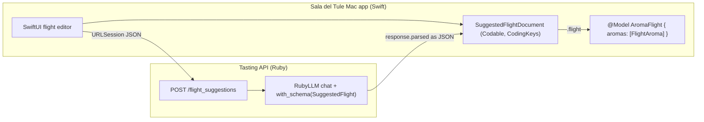

# SwiftData + RubyLLM: an Apple client for an LLM-backed Rails API

**Combines:** SwiftData (Codable and enum properties, @Model basics) and RubyLLM (structured output, Rails integration).

## When to combine

Use this when people work in a native Mac or iPhone app that must keep
working offline, and some suggestions come from an LLM. The model call
stays on the server, with the key, the schema, and the cost. The app stores
what came back as ordinary SwiftData models. A Schematist schema on one
side and a `Codable` document on the other describe the same JSON.

## Source scenarios

| Library | Scenario | What it brings |
| --- | --- | --- |
| SwiftData | [Codable and enums · 08 · Oaxaca aroma flight](https://github.com/MICharisma/swiftdata-multivitamin/tree/main/features/06-codable-and-enums/08-oaxaca-aroma-flight) | `enum FlightAroma: String, Codable, CaseIterable` stored as an ordered array on an `@Model`. |
| SwiftData | [Codable and enums · 09 · Oaxaca label proof](https://github.com/MICharisma/swiftdata-multivitamin/tree/main/features/06-codable-and-enums/09-oaxaca-label-proof) | A separate wire document with `CodingKeys` keeps outside keys out of the stored value. |
| SwiftData | [Codable and enums · 06 · Minas heart cut](https://github.com/MICharisma/swiftdata-multivitamin/tree/main/features/06-codable-and-enums/06-minas-heart-cut) | Explicit JSON `Data` and `Result` at a wire boundary. |
| RubyLLM | [Structured output · 09 · Chengdu panda gate](https://github.com/MICharisma/rubyllm-multivitamin/tree/main/features/04-structured-output/09-chengdu-panda-gate) | `string :gate, enum: %w[open shut]`: the schema limits a field to fixed values. |
| RubyLLM | [Structured output · 02 · Thimphu thangka drawers](https://github.com/MICharisma/rubyllm-multivitamin/tree/main/features/04-structured-output/02-thimphu-thangka-drawers) | `array ... do object do ... end end` for a list of objects. |
| RubyLLM | [Rails integration · 07 · Dar es Salaam farebox usage](https://github.com/MICharisma/rubyllm-multivitamin/tree/main/features/10-rails-integration/07-dar-es-salaam-farebox-usage) | Token usage persisted next to the chat, for billing the tasting room's account. |

## Architecture



## The seams

1. **One list of values, written twice.** The schema's `enum:` list on the
   Ruby side must equal `FlightAroma`'s raw values on the Swift side:
   `"Roasted agave"`, `"Citrus peel"`, `"Wet clay"`, `"Cacao"`. A model
   can't return `"Smoke"` if the schema forbids it, and Swift can't decode it
   if the enum lacks it. Change both in one pull request.
2. **The wire document is not the model.** Follow slot 09: decode into a
   private document type with `CodingKeys`, then build the stored value.
   The `@Model` keeps Swift names; the snake_case keys stay at the edge.
3. **Numbers.** `response.parsed` gives numbers as numbers (RubyLLM
   DISCOVERIES). Swift's `JSONDecoder` decodes `47` into a `Double`, but not
   `"47"`. Keep numeric fields numeric in the schema.

## Worked scenario: Sala del Tule pour for Madrid

On 20 March Elena Ruiz pours lot SC-26 at Sala del Tule in Oaxaca de Juárez
(the chain from SwiftData feature 06). Rafael Vega at Mesa del Agave in
Madrid has asked for a flight order for his first tasting. Elena types her
notes on the iPad, "first sip all horno, then lime zest, finishes like the
clay pots", and asks for a suggested order. The Rails API asks the model to
choose from the four aromas the room's cards already use and returns them
in order. The app stores the flight; Elena edits it before saving.

### Ruby: the schema and the endpoint

> Supplement glue. Schematist `title`, `string ... enum:`, `array ... do
> object do`, `with_schema`, and `parsed` are as used in the RubyLLM
> multivitamin. The controller is ordinary Rails.

```ruby
class SuggestedFlight < Schematist::Schema
  title "suggested_flight"
  description "Tasting order for one mezcal lot, using only the room's aroma cards"

  string :lot_code, description: "Lot code as written, e.g. SC-26"
  array :aromas, description: "Aroma cards in tasting order" do
    object do
      string :card, enum: ["Roasted agave", "Citrus peel", "Wet clay", "Cacao"],
                    description: "The aroma card's exact wording"
      string :why, description: "Six words or fewer, from the taster's notes"
    end
  end
end

class FlightSuggestionsController < ApplicationController
  def create
    notes = params.require(:tasting_notes)
    lot = params.require(:lot_code)

    answer = RubyLLM.chat
      .with_instructions("You order aroma cards for Sala del Tule in Oaxaca. Use only the notes.")
      .with_schema(SuggestedFlight)
      .ask("Lot #{lot}. Notes: #{notes}")

    render json: answer.parsed
  end
end
```

### Swift: decode at the edge, store the enum

> Supplement glue. `FlightAroma` and `AromaFlight` are the types from
> Codable and enums · 08. The document pattern is slot 09's.

```swift
import Foundation
import SwiftData

private struct SuggestedFlightDocument: Decodable {
    struct Card: Decodable {
        let aroma: FlightAroma
        let why: String
        enum CodingKeys: String, CodingKey { case aroma = "card", why }
    }

    let lotCode: String
    let aromas: [Card]

    enum CodingKeys: String, CodingKey {
        case lotCode = "lot_code"
        case aromas
    }
}

enum FlightSuggestionError: Error {
    case unexpectedStatus(Int)
}

@MainActor
func suggestFlight(notes: String, lot: String, into context: ModelContext) async throws -> AromaFlight {
    var request = URLRequest(url: URL(string: "https://tasting.example-api.mx/flight_suggestions")!)
    request.httpMethod = "POST"
    request.setValue("application/json", forHTTPHeaderField: "Content-Type")
    request.httpBody = try JSONEncoder().encode(["tasting_notes": notes, "lot_code": lot])

    let (data, response) = try await URLSession.shared.data(for: request)
    if let http = response as? HTTPURLResponse, http.statusCode != 200 {
        throw FlightSuggestionError.unexpectedStatus(http.statusCode)
    }

    let document = try JSONDecoder().decode(SuggestedFlightDocument.self, from: data)
    let flight = AromaFlight(roomName: "Sala del Tule", aromas: document.aromas.map(\.aroma))
    context.insert(flight)
    return flight
}
```

## Pitfalls

- **Duplicate cards.** The schema allows the same card twice. `AromaFlight`'s
  `toggle(_:)` assumes each aroma appears once. Deduplicate before
  inserting, keeping the first position.
- **Don't store the reason strings in the enum array.** `why` is display
  text for the sheet. If you want to keep it, add a separate Codable struct
  property, as slot 02 does with `RoastMeasure`.
- **Offline is the normal case.** The tasting room's Wi-Fi drops. Save
  Elena's notes as a model first, and fill the flight in when the request
  succeeds. Don't block the editor on the network.
- **The key stays on the server.** Never ship a provider key in the app to
  skip the Rails hop. That's the main reason this guide has a server at all.
- **The hostname above is a placeholder.** `tasting.example-api.mx` is not a
  real service.
