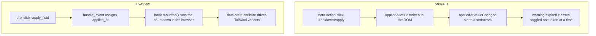

# Phoenix LiveView and Stimulus, side by side

**Combines:** Phoenix (JS commands, client hooks, LiveView lifecycle) and Stimulus (CSS classes, lifecycle callbacks, actions, values).

## When to read this

This one isn't about running the two together on one page. It builds the
same interaction twice, once in each, so you can choose with your eyes
open, or port a screen from one stack to the other. Both libraries put
behavior on server-rendered HTML. They split the work differently:

| Concern | Stimulus | LiveView |
| --- | --- | --- |
| Where state lives | DOM attributes (`data-*-value`) | Server assigns on the socket process |
| Pure client toggle | A controller method and `classList` | `JS.toggle/1`, no round-trip, no hook |
| Element lifecycle | `connect()` / `disconnect()` | Hook `mounted()` / `destroyed()` |
| Timers | `setTimeout` in the controller | `Process.send_after/3` on the server, or a hook interval |
| Talking to siblings | `this.dispatch`, outlets | `push_event`, PubSub, assigns |
| Reconnect behavior | Reconnects when the element moves | Re-mounts when the socket reconnects |

## Source scenarios

| Library | Scenario | What it brings |
| --- | --- | --- |
| Stimulus | [CSS classes · 09 · Turn Point foghorn](https://github.com/MICharisma/stimulus-multivitamin/tree/main/features/11-css-classes/09-turn-point-foghorn) | `static classes = ["sounding"]`; a spread `classList.toggle(...classes)` misbehaves with two tokens. |
| Stimulus | [Lifecycle callbacks · 03 · Live scoreboard poller](https://github.com/MICharisma/stimulus-multivitamin/tree/main/features/02-lifecycle-callbacks/03-live-scoreboard-poller) | `connect()` starts polling, `disconnect()` clears the timer and aborts the request in flight. |
| Stimulus | [Values · 03 · Fog signal board](https://github.com/MICharisma/stimulus-multivitamin/tree/main/features/09-values/03-fog-signal-board) | Boolean values: which attribute strings read as `false`. |
| Phoenix | [JS commands · 01 · Qaarsut frost toggle](https://github.com/MICharisma/phoenix-multivitamin/tree/main/features/12-js-commands/01-qaarsut-frost-toggle) | `JS.toggle/1` with timed transitions, piped into `JS.toggle_attribute/2` for `aria-expanded`. |
| Phoenix | [Client hooks · 01 · Cebu Mactan clock hook](https://github.com/MICharisma/phoenix-multivitamin/tree/main/features/13-client-hooks/01-cebu-mactan-clock-hook) | A colocated hook (`Phoenix.LiveView.ColocatedHook`) with `mounted()` and `destroyed()`. |
| Phoenix | [LiveView lifecycle and events · 01 · Akureyri night watch](https://github.com/MICharisma/phoenix-multivitamin/tree/main/features/06-liveview-lifecycle-and-events/01-akureyri-night-watch) | `connected?/1` gates a `Process.send_after` clock; `handle_event/3` logs a line. |

## Worked scenario: Kiruna de-icing holdover board

At Kiruna Airport, the de-icing pad lead, Saga Niia, sprays a Saab 340 with
Type II fluid at 06:12. The holdover time for the conditions on the card is
20 minutes. The board needs three things: a details drawer she can open and
close, a "Fluid applied" button that logs the time, and a countdown that
turns the row amber at five minutes and red at zero. (Kiruna recurs in the
family: [Routing and plugs · 10 · Kiruna de-ice pad](https://github.com/MICharisma/phoenix-multivitamin/tree/main/features/01-routing-and-plugs/10-kiruna-deice-pad).)



### Stimulus version

> Supplement code, not in the stimulus-multivitamin repo. API shapes as
> used in its controllers.

```js
// holdover_controller.js — registered as "holdover"
import { Controller } from "@hotwired/stimulus"

export default class extends Controller {
  static targets = ["row", "details", "remaining", "log"]
  static classes = ["warning", "expired"]
  static values = { appliedAt: String, holdoverMinutes: { type: Number, default: 20 } }

  toggleDetails() {
    this.detailsTarget.hidden = !this.detailsTarget.hidden
  }

  apply() {
    this.appliedAtValue = new Date().toISOString()
    this.logTarget.textContent = `Type II applied by Saga Niia at ${this.appliedAtValue.slice(11, 16)} UTC.`
  }

  appliedAtValueChanged(appliedAt) {
    this.stopCountdown()
    if (appliedAt) this.countdown = setInterval(() => this.tick(), 1000)
  }

  disconnect() {
    this.stopCountdown()
  }

  tick() {
    const elapsedMs = Date.now() - Date.parse(this.appliedAtValue)
    const remainingMs = this.holdoverMinutesValue * 60_000 - elapsedMs
    this.remainingTarget.textContent = remainingMs > 0 ? `${Math.ceil(remainingMs / 60_000)} min` : "Expired"
    // Loop the tokens. A spread toggle with two tokens treats the second as the force flag (CSS classes · 09).
    for (const token of this.warningClasses) this.rowTarget.classList.toggle(token, remainingMs <= 300_000 && remainingMs > 0)
    for (const token of this.expiredClasses) this.rowTarget.classList.toggle(token, remainingMs <= 0)
  }

  stopCountdown() {
    clearInterval(this.countdown)
  }
}
```

```html
<tbody data-controller="holdover"
       data-holdover-warning-class="bg-amber-100 text-amber-900"
       data-holdover-expired-class="bg-red-100 text-red-900"
       data-holdover-holdover-minutes-value="20">
  <tr data-holdover-target="row">
    <td>SE-KXR · Saab 340</td>
    <td data-holdover-target="remaining">Not sprayed</td>
    <td><button data-action="holdover#apply">Fluid applied</button></td>
    <td><button data-action="holdover#toggleDetails">Details</button></td>
  </tr>
  <tr data-holdover-target="details" hidden>…</tr>
  <tr><td colspan="4" data-holdover-target="log"></td></tr>
</tbody>
```

### LiveView version

> Supplement code, not in the phoenix-multivitamin repo. `JS.toggle/1`,
> `JS.toggle_attribute/2`, colocated hooks, and `handle_event/3` are as used
> there.

```elixir
defmodule PhoenixMultivitaminWeb.KirunaHoldoverBoardLive do
  use PhoenixMultivitaminWeb, :live_view

  @impl true
  def mount(_params, _session, socket) do
    {:ok, assign(socket, page_title: "Kiruna holdover board", applied_at: nil, log: [])}
  end

  @impl true
  def handle_event("apply_fluid", _params, socket) do
    applied_at = DateTime.utc_now() |> DateTime.truncate(:second)
    line = "Type II applied by Saga Niia at #{Calendar.strftime(applied_at, "%H:%M")} UTC"
    {:noreply, socket |> assign(:applied_at, applied_at) |> update(:log, &[line | &1])}
  end

  @impl true
  def render(assigns) do
    ~H"""
    <div id="se-kxr" phx-hook=".Holdover"
         data-applied-at={@applied_at && DateTime.to_iso8601(@applied_at)} data-minutes="20"
         class="data-[state=warning]:bg-amber-100 data-[state=expired]:bg-red-100">
      <span>SE-KXR · Saab 340</span> <span data-remaining>Not sprayed</span>
    </div>
    <button phx-click="apply_fluid">Fluid applied</button>
    <button id="toggle-details" aria-expanded="false"
            phx-click={JS.toggle(to: "#se-kxr-details") |> JS.toggle_attribute({"aria-expanded", "true", "false"})}>
      Details
    </button>
    <div id="se-kxr-details" class="hidden">…</div>
    <ol><li :for={line <- @log}>{line}</li></ol>

    <script :type={Phoenix.LiveView.ColocatedHook} name=".Holdover">
      export default {
        mounted() { this.timer = window.setInterval(() => this.tick(), 1000) },
        updated() { this.tick() },
        destroyed() { window.clearInterval(this.timer) },
        tick() {
          const appliedAt = this.el.dataset.appliedAt
          if (!appliedAt) return
          const remainingMs = Number(this.el.dataset.minutes) * 60000 - (Date.now() - Date.parse(appliedAt))
          this.el.querySelector("[data-remaining]").textContent =
            remainingMs > 0 ? `${Math.ceil(remainingMs / 60000)} min` : "Expired"
          this.el.dataset.state = remainingMs <= 0 ? "expired" : remainingMs <= 300000 ? "warning" : "ok"
        }
      }
    </script>
    """
  end
end
```

## The seams worth comparing

1. **Who owns `applied_at`.** In Stimulus it's a DOM attribute, so a Turbo
   page replacement that re-renders the row from the server loses it unless
   the server wrote it. In LiveView it's an assign, so a reconnect re-renders
   it from the process. But see the `phx-update="ignore"` pitfall below.
2. **The toggle.** `JS.toggle` and a Stimulus `toggleDetails()` both avoid
   the server. Only the LiveView version keeps `aria-expanded` in sync with
   no extra code, because `JS.toggle_attribute` is piped onto the same click.
3. **Teardown.** `disconnect()` and `destroyed()` are the same promise:
   clear the interval. Stimulus calls `disconnect()` when the element merely
   moves (Lifecycle · 03 and · 08). A hook's `destroyed()` runs when
   LiveView removes the element.

## Pitfalls

- **`phx-update="ignore"` would freeze `data-applied-at`.** The Cebu clock
  uses `phx-update="ignore"` so LiveView won't overwrite the hook's text.
  Copying that here would also stop `data-applied-at` from ever updating
  after "Fluid applied". So the board leaves the row patchable, and the hook
  calls `tick()` from `updated()` to put back the text and `data-state` that
  a patch resets.
- **Spread toggles.** `classList.toggle(...this.warningClasses)` with
  `"bg-amber-100 text-amber-900"` forces the first class on and never
  toggles the second (CSS classes · 09). Loop the tokens.
- **Targets must be inside the controller.** The details row is a sibling
  of the aircraft row, so the controller goes on the `<tbody>`, not the
  first `<tr>`. Put it on the `<tr>` and `detailsTarget` throws.
- **Tailwind needs to see class names.** The `data-[state=warning]:`
  variants work only if Tailwind scans the `.ex` file. In Stimulus, classes
  in `data-holdover-warning-class` need to be in a scanned file too.
- **Clock skew.** Both versions trust the browser clock against a
  server-stamped time. A tablet on the pad with a wrong clock shows the wrong
  holdover. For a safety display, send the remaining seconds, not the
  timestamp.
