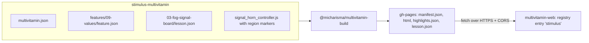

# Stimulus + multivitamin-web: authoring a catalog the client can render

**Combines:** Stimulus (values, dispatching events), multivitamin-web (React 19 client), and `@micharisma/multivitamin-build` (the artifact builder).

## When to combine

Use this when a multivitamin should be readable in the shared web client
with step-by-step highlighting. So far only RubyLLM is published, and Phoenix
is annotated on a trial branch. Stimulus is the next natural one because
its scenarios are complete (15 of 15 features). It also brings a problem the
Ruby catalog didn't have: every scenario is at least two files, an
`index.html` and one or more controllers.

## Source scenarios and files

| Piece | Where | What it brings |
| --- | --- | --- |
| Stimulus | [Values · 03 · Fog signal board](https://github.com/MICharisma/stimulus-multivitamin/tree/main/features/09-values/03-fog-signal-board) | One controller (`signal_horn_controller.js`) plus `index.html`: the simplest two-file case. |
| Stimulus | [Dispatching events · 04 · Lopez freight bell](https://github.com/MICharisma/stimulus-multivitamin/tree/main/features/13-dispatching-events/04-lopez-freight-bell) | Five controllers in one scenario: the case that needs `file#region` names. |
| RubyLLM | [`multivitamin.json` on `highlighting-trial`](https://github.com/MICharisma/rubyllm-multivitamin/blob/highlighting-trial/multivitamin.json) and [Chat basics `feature.json`](https://github.com/MICharisma/rubyllm-multivitamin/blob/highlighting-trial/features/01-chat-basics/feature.json) | The metadata shape already published. |
| Phoenix | [Routing and plugs · 01 · Lukla shear gate `lesson.json`](https://github.com/MICharisma/phoenix-multivitamin/blob/highlighting-trial/features/01-routing-and-plugs/01-lukla-shear-gate/lesson.json) | A multi-file lesson: steps naming `shear_gate_plug.ex#name-approach` and `shear_gate_html.ex#plug-order`. |
| Web client | [`src/registry.ts`](https://github.com/MICharisma/multivitamin-web/blob/cursor/multivitamin-web-v1-b7f7/src/registry.ts) and [`src/data/types.ts`](https://github.com/MICharisma/multivitamin-web/blob/cursor/multivitamin-web-v1-b7f7/src/data/types.ts) on PR #1 | One registry entry per multivitamin; `Lesson`, `StepRegion` (with optional `file`), `Highlights`. |

## Architecture



## The seams

1. **The artifact format is the contract.** The client reads
   `manifest.json` with `formatVersion: 1`, and per example `html`,
   `lesson`, and `highlights` (see the multivitamin-web README). Anything the
   build emits in that shape renders. Anything else falls back to plain code.
2. **Region names are the join key.** A lesson step's region name must match
   a `region:` marker in the source. For any file other than the lesson's
   `source`, prefix it: `index.html#horn-markup`.
3. **The client shows one file today.** `ExampleEntry` has a single `source`
   and `html`. Steps that name another file still list, but their lines
   aren't on screen. Phoenix hit the same wall. Both need file tabs in the
   client (see the PR notes).

## Worked scenario: Fog signal board in the client

Values · 03 teaches Boolean values with the Point Wilson horn: `""`, `"00"`,
`"no"`, and `"false "` all read as `true`, and only a missing attribute is
the default `false`. Annotate it so the client walks through three steps:
declare the values, flip them from actions, read them back in `render()`.

### `multivitamin.json` (repo root)

```json
{
  "name": "stimulus",
  "title": "Stimulus multivitamin",
  "language": "javascript",
  "grammar": "javascript",
  "repo": "MICharisma/stimulus-multivitamin",
  "features": ["09-values"]
}
```

### `features/09-values/03-fog-signal-board/lesson.json`

```json
{
  "title": "Fog signal board",
  "source": "signal_horn_controller.js",
  "steps": [
    {
      "label": "Declare sounding and manned as Boolean values",
      "api": "Controller.values",
      "regions": [{ "name": "declare-values", "role": "primary" }]
    },
    {
      "label": "Sound and silence the horn by assigning the value",
      "api": "this.soundingValue =",
      "regions": [
        { "name": "flip-sounding", "role": "primary" },
        { "name": "index.html#horn-markup", "role": "setup" }
      ]
    },
    {
      "label": "Read the value, the raw attribute, and hasSoundingValue",
      "api": "this.hasSoundingValue",
      "regions": [{ "name": "read-back", "role": "result" }]
    }
  ]
}
```

### Markers in `signal_horn_controller.js`

> **Assumption to verify.** The highlighting spec defines markers as
> `# region: name`, `# endregion: name`, and `# focus: expr`, and the
> Phoenix trial added HEEx's `<%!-- region: … --%>`. A JavaScript catalog
> needs `// region:` and HTML needs `<!-- region: -->`. Confirm the build
> package recognizes them, or add them, before annotating 195 scenarios.

```js
export default class extends Controller {
  static targets = ["hornName", "reading"]
  // region: declare-values
  // focus: sounding: Boolean
  static values = {
    sounding: Boolean,
    manned: Boolean
  }
  // endregion: declare-values

  // region: flip-sounding
  soundHorn() {
    this.sounding = true
  }

  silenceHorn() {
    this.sounding = false
  }
  // endregion: flip-sounding

  // render() is unchanged, wrapped in a read-back region.
}
```

### TypeScript: register it in the client

```ts
// src/registry.ts — add after the rubyllm entry
{
  id: "stimulus",
  title: "Stimulus",
  manifestUrl: "https://micharisma.github.io/stimulus-multivitamin/manifest.json",
},
```

That URL doesn't exist yet. Stimulus has no GitHub Pages site. Guide 08
covers publishing.

## Pitfalls

- **`api` strings aren't checked against anything.** `feature.json`'s
  `covers` list and each step's `api` are free text today. Pick one style per
  catalog (`Controller.values`, `this.dispatch`) and keep it.
- **Markers survive the build only in the source, not the runtime page.**
  The build strips markers from the highlighted HTML. The scenario's live
  `index.html` still loads the annotated controller, so comment lines show
  up in the browser's devtools. That's harmless, but say so in
  CONTRIBUTING.
- **Five controllers, one `source`.** For Lopez freight bell, choose the
  controller the lesson is about (`freight_desk_controller.js`) as `source`
  and prefix every other file. Until the client has tabs, a reader sees only
  the source file.
- **The index page is a catalog too.** Stimulus has its own `index.html`
  catalog. Don't let the two drift: generate one list from
  `multivitamin.json` if both stay.
