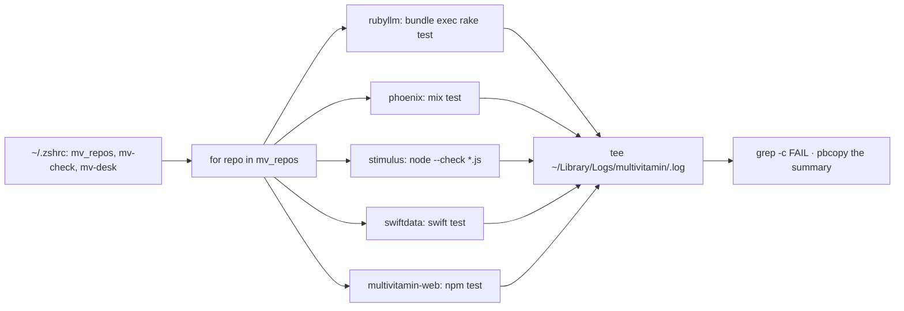

# Terminal + every multivitamin: one shell session across the family

**Combines:** Terminal (navigation, pipes, processes, curl, zsh config) with RubyLLM, Phoenix, Stimulus, SwiftData, and multivitamin-web.

## When to combine

Every other multivitamin assumes a terminal and never teaches it. This guide
is the reverse: the shell is the subject, and the other repos are the
realistic things you point it at. Use it before a release, when a
contributor's machine is new, or to see why one repo's CI is red.

> **Terminal multivitamin status.** [MICharisma/terminal-multivitamin](https://github.com/MICharisma/terminal-multivitamin)
> is brand new. Its first version is being built on a branch as this is
> written. Its planned features include navigation, pipes and redirection,
> grep/find/sed/awk, processes and jobs, curl, Homebrew, zsh configuration,
> and macOS tools (`open`, `pbcopy`, `defaults`, `launchctl`). This guide
> links to the repo root. Each section names the planned feature it leans on,
> so the links can be tightened once those folders exist.

## Source scenarios and commands

Every command below is copied from a repo's README, its `Rakefile`/`mix.exs`/`package.json`, or its `.github/workflows/test.yml`.

| Repo | Run the checks | Where it says so |
| --- | --- | --- |
| RubyLLM | `bundle exec rake test` (plays cassettes) | [`.github/workflows/test.yml`](https://github.com/MICharisma/rubyllm-multivitamin/blob/main/.github/workflows/test.yml) |
| Phoenix | `mix deps.get`, `mix compile --warnings-as-errors`, `mix test` | [`.github/workflows/test.yml`](https://github.com/MICharisma/phoenix-multivitamin/blob/main/.github/workflows/test.yml) |
| Stimulus | `node --check` on every `.js`, copied to `.mjs` first; `npx serve .` to browse | [`.github/workflows/test.yml`](https://github.com/MICharisma/stimulus-multivitamin/blob/main/.github/workflows/test.yml), [README](https://github.com/MICharisma/stimulus-multivitamin#run-the-examples-locally) |
| SwiftData | `swift test`, `swift run SwiftDataMultivitamin` (macOS runner) | [`.github/workflows/test.yml`](https://github.com/MICharisma/swiftdata-multivitamin/blob/main/.github/workflows/test.yml) |
| multivitamin-web | `npm test` (`vitest run`), `npm run build` (`tsc -b && vite build`) | [`package.json` on PR #1](https://github.com/MICharisma/multivitamin-web/blob/cursor/multivitamin-web-v1-b7f7/package.json) |

## Architecture



## The seams

1. **Exit status is the contract.** Every runner above exits non-zero on
   failure. The shell loop only needs `$?`, never the output format.
2. **Each repo pins its own toolchain.** Ruby ≥ 3.2 (`Gemfile`), Elixir
   1.17+ with OTP 27+ (Phoenix README), Node 22 (Stimulus CI), Xcode for
   SwiftData. A loop that runs them all inherits whichever versions are on
   `PATH`. Print them first.
3. **Ports.** Phoenix's dev server takes 4000 and Vite takes 5173. Stimulus
   uses whatever `npx serve` picks. Check before starting a second copy.

## Worked scenario: Inês checks the family before a Saturday release in Porto

Inês Carvalho maintains the catalogs from a MacBook in a co-working space
on Rua de Cedofeita in Porto. Before Saturday's release she wants one
command that runs every repo's checks, keeps a dated log, and puts a
one-line summary on the clipboard for the release note. Then she wants to
poke the Phoenix METAR desk's JSON route and open the Stimulus catalog in
Safari.

### zsh: the loop (planned features: zsh config, processes, pipes)

```zsh
# ~/.zshrc
typeset -A mv_checks=(
  rubyllm-multivitamin   'bundle exec rake test'
  phoenix-multivitamin   'mix test'
  stimulus-multivitamin  'for f in $(git ls-files "*.js"); do cp $f /tmp/check.mjs && node --check /tmp/check.mjs || exit 1; done'
  swiftdata-multivitamin 'swift test'
  multivitamin-web       'npm test'
)

mv-check() {
  local log=~/Library/Logs/multivitamin/$(date +%F).log
  mkdir -p ${log:h}
  local -a failed=()
  print "ruby $(ruby -e 'print RUBY_VERSION') · elixir $(elixir --short-version) · node $(node -v)" | tee $log
  for repo in ${(ko)mv_checks}; do
    print -P "%B== $repo%b"
    ( cd ~/code/$repo && eval $mv_checks[$repo] ) >>$log 2>&1 || failed+=$repo
  done
  local summary="${#mv_checks} repos checked, ${#failed} failed${failed:+: ${(j:, :)failed}}"
  print $summary | tee -a $log | pbcopy
  print $summary
}
```

### curl and jq: hit a real route (planned feature: curl)

```sh
cd ~/code/phoenix-multivitamin && mix phx.server &      # job control: %1
curl -s localhost:4000/features/03-controllers-and-json/01-queenstown-metar-desk/metar/export \
  | jq -r '.metar | "\(.station) \(.wind) QNH \(.qnh)"'
# NZQN 32015G28KT QNH 1008
kill %1
```

The route and the `@metar` map come from
[Controllers and JSON · 01 · Queenstown METAR desk](https://github.com/MICharisma/phoenix-multivitamin/tree/main/features/03-controllers-and-json/01-queenstown-metar-desk).

### macOS tools: open and pbcopy (planned feature: macOS tools)

```sh
cd ~/code/stimulus-multivitamin && npx serve . &
open -a Safari "http://localhost:3000/features/11-css-classes/09-turn-point-foghorn/"
git -C ~/code/rubyllm-multivitamin log -1 --format='%h %s' | pbcopy
```

### Find and grep across repos (planned feature: grep/find)

Which scenarios across the family mention Kiruna?

```sh
grep -rl --include='*.md' -i 'kiruna' ~/code/*-multivitamin/features | sed -E 's#.*/(features/[^/]+/[^/]+)/.*#\1#' | sort -u
```

## Pitfalls

- **`eval` and quoting.** The Stimulus entry holds a whole loop in a
  string. That's fine in your own `.zshrc`; don't build those strings from
  anything you didn't write.
- **zsh is not bash.** `${(ko)mv_checks}` (sorted keys), `${log:h}` (dirname),
  and `${(j:, :)failed}` (join) are zsh-only. The Terminal multivitamin's
  zsh feature is where those flags get explained.
- **`npx serve` port.** `serve` defaults to 3000 but picks another if 3000
  is busy, and prints the one it chose. Read it before `open`.
- **Cassettes vs live keys.** `bundle exec rake test` plays cassettes by
  default. A stray `LIVE=1` left in the environment turns recording on,
  overwrites cassettes, and spends money (RubyLLM README). Run the loop with
  `LIVE= mv-check` if you're unsure.
- **`swift test` is macOS-only here.** The SwiftData CI uses a macOS runner.
  On Linux, skip that repo.
