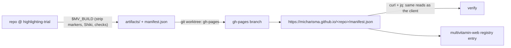

# The build package + Terminal: publishing a catalog from the shell

**Combines:** `@micharisma/multivitamin-build`, Terminal (git, curl, jq, shell scripting), GitHub Pages, and multivitamin-web as the consumer.

## When to combine

Use this when a multivitamin's markers and lesson files are ready and you
want the web client to show them. The build package turns a repo into
static artifacts. The shell puts them on a `gh-pages` branch and checks them
the way the client will read them. This is how the RubyLLM catalog was first
published, by hand, before any CI workflow existed.

## What's real today

| Thing | Status | Evidence |
| --- | --- | --- |
| RubyLLM artifacts on GitHub Pages | Published from `highlighting-trial @ 7952b73` | [`manifest.json`](https://micharisma.github.io/rubyllm-multivitamin/manifest.json), [`gh-pages` branch](https://github.com/MICharisma/rubyllm-multivitamin/tree/gh-pages) |
| Manifest format | `formatVersion: 1`, `builder: { name: "@micharisma/multivitamin-build", version: "0.1.0" }`, `commit`, `builtAt`, features → examples with `source`, `html`, `highlights`, `lesson`, `stepCount` | Same manifest |
| CORS | GitHub Pages serves `access-control-allow-origin: *` on the manifest | `curl -sI` below |
| Phoenix annotations | On `highlighting-trial`, not published | [phoenix-multivitamin@highlighting-trial](https://github.com/MICharisma/phoenix-multivitamin/tree/highlighting-trial) |
| The build package's source | **Not on GitHub yet.** It's committed only on the maintainer's Mac, including the HEEx-comment and per-extension highlighting changes. | — |
| A CI publish workflow | **Doesn't exist.** multivitamin-web deliberately has no deploy workflow, and nothing has been deployed beyond the RubyLLM Pages site. | multivitamin-web README |

Because the package isn't public, this guide calls its command `$MV_BUILD`.
Set it to the real invocation once the package is pushed. Don't guess a
command name.

## Architecture



## The seams

1. **`formatVersion` and `highlights.version`.** The client renders code
   only (no steps) when the manifest's `formatVersion` is unknown, and
   lists steps without highlighting when `highlights.json`'s `version` is
   unknown. Check both after every build.
2. **Paths resolve against the manifest URL.** `source`, `html`,
   `highlights`, and `lesson` are manifest-relative
   (`01-chat-basics/01-bengaluru-inverter-board/lesson.json`). Publish the
   folder as-is. Moving `manifest.json` breaks every path.
3. **`commit` is the cache key.** The client includes the manifest's version
   stamp in its query keys, so a rebuilt catalog never mixes old and new
   artifacts. Always build from a committed tree, not a dirty one.

## Worked scenario: publishing Phoenix's routing-and-plugs trial

Phoenix's `highlighting-trial` branch annotates all 13 Routing and plugs
scenarios, from the Lukla shear gate to the Ushuaia austral pipeline. The
check passes and 363 tests pass. To show it in the client, publish it to
`micharisma.github.io/phoenix-multivitamin`, the same way RubyLLM went out.

### Shell: build into a worktree and push `gh-pages`

```zsh
#!/usr/bin/env zsh
set -euo pipefail

repo=phoenix-multivitamin
branch=highlighting-trial
: ${MV_BUILD:?set MV_BUILD to the build package command, e.g. the one used for rubyllm}

cd ~/code/$repo
git switch $branch && git pull --ff-only
[[ -z $(git status --porcelain) ]] || { print -u2 "dirty tree; commit first"; exit 1 }
sha=$(git rev-parse --short HEAD)

out=$(mktemp -d)
eval "$MV_BUILD --out $out"            # flags depend on the package; confirm them

# gh-pages lives in its own worktree so the source checkout never changes branch.
git fetch origin gh-pages 2>/dev/null || true
git worktree add -f ../$repo-pages gh-pages 2>/dev/null \
  || git worktree add --orphan -b gh-pages ../$repo-pages
rsync -a --delete --exclude .git $out/ ../$repo-pages/
touch ../$repo-pages/.nojekyll         # RubyLLM's gh-pages has one; keeps _-prefixed files

git -C ../$repo-pages add -A
git -C ../$repo-pages commit -m "Publish highlighting artifacts from $branch @ $sha"
git -C ../$repo-pages push origin gh-pages
```

The commit message matches the one on RubyLLM's `gh-pages`
(`Publish highlighting artifacts from highlighting-trial @ 7952b73`), so
`git log` reads the same in both repos.

### curl + jq: read it the way the client does

```sh
base=https://micharisma.github.io/phoenix-multivitamin
curl -sI $base/manifest.json | grep -i '^access-control-allow-origin'
curl -s $base/manifest.json | jq -e '.formatVersion == 1' >/dev/null && echo "format ok"

# Every example's four paths must resolve.
curl -s $base/manifest.json \
  | jq -r '.features[].examples[] | .source, .html, .highlights, .lesson' \
  | while read -r path; do
      code=$(curl -s -o /dev/null -w '%{http_code}' "$base/$path")
      [[ $code == 200 ]] || echo "$code $path"
    done
```

Run the same two checks against RubyLLM today and they pass:
`access-control-allow-origin: *`, and `formatVersion` 1 at commit `7952b73`.

### TypeScript: the one-line client change

```ts
{ id: "phoenix", title: "Phoenix", manifestUrl: "https://micharisma.github.io/phoenix-multivitamin/manifest.json" },
```

## Pitfalls

- **Pages must be turned on once.** RubyLLM's Pages site serves the
  `gh-pages` branch from `/`. A new repo needs the same setting (`gh api
  repos/MICharisma/<repo>/pages` shows it). Without it the push succeeds and
  the URL 404s.
- **Publishing is deploying.** multivitamin-web deliberately has no deploy
  workflow. Publishing one catalog's artifacts is a smaller step, but the
  result is public. Decide on purpose.
- **Multi-file examples.** Phoenix lessons point at plug, controller, and
  HTML files. The manifest lists one `source`/`html` per example, so steps on
  other files won't be visible until the client has file tabs.
- **`rsync --delete` into the wrong folder** deletes your work. The script
  pins the destination to the worktree. Keep it that way.
- **Don't push from a feature branch's tree by accident.** The script
  switches to `highlighting-trial` explicitly. Change `branch` on purpose,
  never by leaving it on whatever was checked out.
