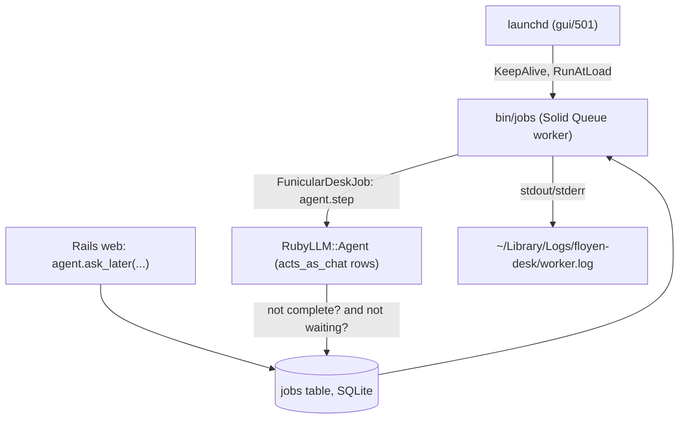

# RubyLLM durable agents + Terminal: a job worker under launchd

**Combines:** RubyLLM (durable agents and Rails, Rails integration) and Terminal (processes, macOS tools: `launchctl`, logs).

## When to combine

Durable agents make one persisted move per job and re-enqueue until the
agent is `complete?` or `waiting?`. That only works if a worker process is
always there to pick up the next job. On a small office Mac, the
lowest-ceremony supervisor is launchd: it starts the worker at login,
restarts it if it dies, and keeps its logs. RubyLLM makes the work safe to
interrupt. launchd makes sure something resumes it.

## Source scenarios

| Library | Scenario | What it brings |
| --- | --- | --- |
| RubyLLM | [Durable agents · 01 · Kyoto torii watch](https://github.com/MICharisma/rubyllm-multivitamin/tree/main/features/30-durable-agents-and-rails/01-kyoto-torii-watch) | `RubyLLM::Agent` with `chat_model`, `tools`, `instructions`; a job that calls `step` and re-enqueues unless `complete? \|\| waiting?`. |
| RubyLLM | [Durable agents · 03 · Cusco terrace checkpoint](https://github.com/MICharisma/rubyllm-multivitamin/tree/main/features/30-durable-agents-and-rails/03-cusco-terrace-checkpoint) | `ActiveJob::Continuable` checkpoints after each `chat.step` and resumes after an interruption. |
| RubyLLM | [Durable agents · 04 · Zanzibar dhow permit](https://github.com/MICharisma/rubyllm-multivitamin/tree/main/features/30-durable-agents-and-rails/04-zanzibar-dhow-permit) | `requires_approval` parks a job; another record approves by ID before the work completes. |
| RubyLLM | [Durable agents · 05 · Bergen Fløyen closure](https://github.com/MICharisma/rubyllm-multivitamin/tree/main/features/30-durable-agents-and-rails/05-bergen-floyen-closure) | A denial recorded in the web process is honored by the resumed worker without running the tool. |
| RubyLLM | [Durable agents · 07 · Luang Prabang boat receipt](https://github.com/MICharisma/rubyllm-multivitamin/tree/main/features/30-durable-agents-and-rails/07-luang-prabang-boat-receipt) | At-least-once tool execution needs a durable business key. |
| RubyLLM | [Durable agents · 12 · Rapa Nui quarry stop](https://github.com/MICharisma/rubyllm-multivitamin/tree/main/features/30-durable-agents-and-rails/12-rapa-nui-quarry-stop) | `cancelled` is a persisted request the next worker checkpoint consumes. No HTTP needed. |
| Terminal | [terminal-multivitamin](https://github.com/MICharisma/terminal-multivitamin) (planned: processes, macOS tools) | `launchctl bootstrap`, `kickstart`, `print`; `tail -f` on the worker log. |

## Architecture



## The seams

1. **The process boundary is the job boundary.** The worker may die
   between any two `step`s. Everything the next step needs is in the
   database: `Agent.find(id)` restores tools, instructions, and history
   (Kyoto, slot 01).
2. **launchd only knows exit codes.** `KeepAlive` restarts the worker
   whenever it exits. It doesn't know a job was half done. That's the job's
   problem, solved by persisting before acting (Luang Prabang, slot 07).
3. **Cancellation crosses the boundary as data.** The web process calls
   `cancel` on the chat record. The worker's next `step` raises
   `RubyLLM::CancelledError` and consumes the request (Rapa Nui, slot 12).
   Don't try to signal the worker process from Rails.

## Worked scenario: Fløibanen closure desk in Bergen

The Fløibanen funicular office at Vetrlidsallmenningen in Bergen keeps a
Mac mini under the ticket counter. When the wind at Fløyen top station
passes 20 m/s, the duty officer, Sigrid Haugland, asks the closure agent to
check the anemometer tool, draft the closure notice in Norwegian and
English, and wait for her approval before posting it. The agent's job
runs on the Mac mini, under launchd, so a power blip at 02:00 doesn't strand
a half-finished notice.

### Ruby: the agent and its job

> Supplement glue. `RubyLLM::Agent`, `chat_model`, `model`, `tools`,
> `instructions`, `find`, `step`, `complete?`, `waiting?`, and `ask_later`
> are as used in Durable agents · 01. In the RubyLLM repo the job base class
> is `Multivitamin::DurableJob` and jobs are drained in-process for tests.
> Here it's a plain `ApplicationJob` run by Solid Queue's `bin/jobs`, which
> is Rails 8's default and isn't part of the repo.

```ruby
class FloyenWind < RubyLLM::Tool
  description "Reads the anemometer at Fløyen top station, Bergen"
  def self.tool_name = "floyen_wind"
  def execute = AnemometerReading.latest.then { { mean_ms: _1.mean_ms, gust_ms: _1.gust_ms, at: _1.read_at.iso8601 } }
end

class ClosureAgent < RubyLLM::Agent
  chat_model ClosureLog
  model "gpt-4.1-mini", provider: :openai
  tools FloyenWind
  instructions <<~TEXT
    You keep the Fløibanen closure desk in Bergen. Call floyen_wind first.
    Above 20 m/s gusts, draft a closure notice in Norwegian, then English.
  TEXT
end

class FunicularDeskJob < ApplicationJob
  queue_as :closure_desk

  def perform(closure_log_id)
    desk = ClosureAgent.find(closure_log_id)
    desk.step
    self.class.perform_later(closure_log_id) unless desk.complete? || desk.waiting?
  rescue RubyLLM::CancelledError
    # Rapa Nui: Sigrid pressed "Stand down" in the web app, which called
    # ClosureLog.find(id).cancel. step consumed the request and raised. Don't re-enqueue.
    Rails.logger.info("closure desk #{closure_log_id} stood down")
  end
end
```

> The web side stands the agent down with `ClosureLog.find(id).cancel`,
> exactly as Rapa Nui (slot 12) does. The next `step` raises
> `RubyLLM::CancelledError` and clears the request. `CancelledError`
> inherits `StandardError`, not `RubyLLM::Error`.

### launchd: the worker as a LaunchAgent

```xml
<?xml version="1.0" encoding="UTF-8"?>
<!DOCTYPE plist PUBLIC "-//Apple//DTD PLIST 1.0//EN" "http://www.apple.com/DTDs/PropertyList-1.0.dtd">
<!-- ~/Library/LaunchAgents/no.floibanen.closure-desk.plist -->
<plist version="1.0">
<dict>
  <key>Label</key>             <string>no.floibanen.closure-desk</string>
  <key>WorkingDirectory</key>  <string>/Users/desk/floyen-desk</string>
  <key>ProgramArguments</key>
  <array>
    <string>/bin/zsh</string><string>-lc</string><string>exec bin/jobs</string>
  </array>
  <key>EnvironmentVariables</key>
  <dict><key>RAILS_ENV</key><string>production</string></dict>
  <key>RunAtLoad</key>         <true/>
  <key>KeepAlive</key>         <true/>
  <key>ThrottleInterval</key>  <integer>30</integer>
  <key>StandardOutPath</key>   <string>/Users/desk/Library/Logs/floyen-desk/worker.log</string>
  <key>StandardErrorPath</key> <string>/Users/desk/Library/Logs/floyen-desk/worker.log</string>
</dict>
</plist>
```

### zsh: load it, poke it, watch it

```zsh
plist=~/Library/LaunchAgents/no.floibanen.closure-desk.plist
plutil -lint $plist
mkdir -p ~/Library/Logs/floyen-desk
launchctl bootstrap gui/$(id -u) $plist
launchctl print gui/$(id -u)/no.floibanen.closure-desk | grep -E 'state|pid|last exit'
launchctl kickstart -k gui/$(id -u)/no.floibanen.closure-desk   # restart after a deploy
tail -f ~/Library/Logs/floyen-desk/worker.log | grep --line-buffered FunicularDeskJob
launchctl bootout gui/$(id -u)/no.floibanen.closure-desk          # unload
```

## Pitfalls

- **The XML declaration comes first.** Nothing, not even a comment, may
  precede `<?xml ...?>`. `plutil -lint` catches it.
- **`zsh -lc` for the right Ruby.** launchd starts with a bare `PATH`.
  Without a login shell, `bin/jobs` finds the system Ruby, not the one in
  `.zshrc`. `exec` keeps the worker as the process launchd watches.
- **Secrets aren't in the plist.** The provider key belongs in Rails
  credentials or the keychain, not in `EnvironmentVariables`, which any
  local user can read with `launchctl print`.
- **Restart loops.** If the worker crashes on boot, `KeepAlive` restarts it
  forever. `ThrottleInterval` slows it down. The log tells you why.
- **At-least-once means twice sometimes.** A worker killed after the tool
  ran but before the row was saved runs the tool again on resume. Posting a
  closure notice must use a durable key (Luang Prabang, slot 07), or two
  notices go up.
- **Waiting is not stuck.** A job that stops re-enqueueing because the
  agent is `waiting?` for Sigrid's approval is correct. Don't add a
  watchdog that "fixes" it.
- **The Mac mini sleeps.** Energy settings can sleep a headless Mac. Use
  `pmset` or System Settings to keep it awake, or launchd has nothing to run
  on.
