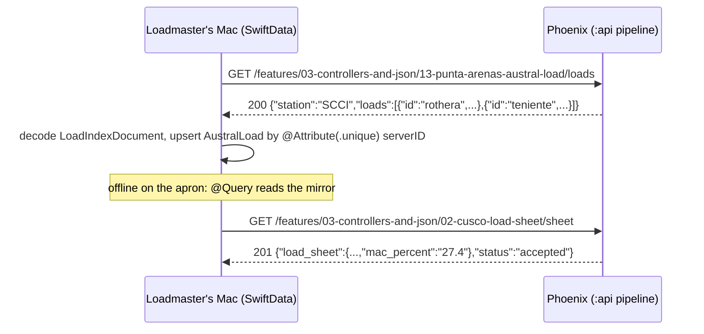

# SwiftData + Phoenix: a Mac app that mirrors a Phoenix JSON API

**Combines:** SwiftData (attributes, Codable and enums, @Model basics) and Phoenix (controllers and JSON).

## When to combine

Use this when a Phoenix app is the shared source of truth and someone
needs the data offline in a native app: a loadmaster on an apron with no
signal, a clerk on a flight. Phoenix serves JSON with `json/2`. SwiftData
keeps a local mirror keyed by the server's ids. No LLM is involved. This is
the plain data seam that guides 02 and 04 build on.

## Source scenarios

| Library | Scenario | What it brings |
| --- | --- | --- |
| Phoenix | [Controllers and JSON · 13 · Punta Arenas austral load](https://github.com/MICharisma/phoenix-multivitamin/tree/main/features/03-controllers-and-json/13-punta-arenas-austral-load) | A JSON index (`GET .../loads` → `{station, loads: [...]}`) sorted by id, plus `create` answering `201` with `json/2`. |
| Phoenix | [Controllers and JSON · 02 · Cusco load sheet](https://github.com/MICharisma/phoenix-multivitamin/tree/main/features/03-controllers-and-json/02-cusco-load-sheet) | `put_status(:created)` before `json/2`: the client sees `201`, not `200`. `mac_percent` is a **string** (`"27.4"`) next to integer kilograms. |
| SwiftData | [Attributes · 01 · Lucanas ear mark](https://github.com/MICharisma/swiftdata-multivitamin/tree/main/features/02-attributes/01-lucanas-ear-mark) | `@Attribute(.unique)` on one stored property. |
| SwiftData | [Codable and enums · 09 · Oaxaca label proof](https://github.com/MICharisma/swiftdata-multivitamin/tree/main/features/06-codable-and-enums/09-oaxaca-label-proof) | A private wire document with `CodingKeys`, separate from the stored model. |
| SwiftData | [Codable and enums · 05 · Minas clay still](https://github.com/MICharisma/swiftdata-multivitamin/tree/main/features/06-codable-and-enums/05-minas-clay-still) | `#Predicate` with `SortDescriptor` for reading the mirror back. |

## Architecture



## The seams

1. **Server id is the unique key.** Phoenix's loads carry `id:
   "teniente"`. Store it as `@Attribute(.unique) var serverID`. Inserting a
   model whose unique value already exists updates that row instead of
   adding a duplicate, so a refresh is just "insert everything again".
2. **Status codes aren't all 200.** Cusco answers `201 Created` to a
   `GET`. A Swift client that checks `statusCode == 200` treats a good sheet
   as a failure. Accept `200..<300`.
3. **Types on the wire are Phoenix's choice.** `mac_percent` is `"27.4"`, a
   string, because the Elixir map literal says so. `takeoff_weight_kg` is an
   integer. The wire document must mirror that exactly, then convert.

## Worked scenario: Punta Arenas Antarctic loads, offline at the hangar

Cristóbal is loadmaster for the C-130 runs from Punta Arenas (SCCI) to
Teniente Marsh and Rothera. Hangar 3 at Presidente Carlos Ibáñez del Campo
has patchy Wi-Fi, so he syncs the load list at the operations desk and works
from the mirror on the ramp: fuel bladders, 9,600 kg, to Teniente Marsh;
science crates, 7,200 kg, to Rothera. The same app also reads the Cusco
load sheet, his colleague Inti's 737 at SPZO, as a cross-check on the
sheet format.

### Swift: models and wire documents

> Supplement code, not in the swiftdata-multivitamin repo. `@Model`,
> `@Attribute(.unique)`, `CodingKeys` on a separate document, and
> `#Predicate` are as used there.

```swift
import Foundation
import SwiftData

@Model
final class AustralLoad {
    @Attribute(.unique) var serverID: String
    var loadmaster: String
    var craft: String
    var destination: String
    var cargo: String
    var kilograms: Int
    var syncedAt: Date

    init(serverID: String, loadmaster: String, craft: String, destination: String,
         cargo: String, kilograms: Int, syncedAt: Date) {
        self.serverID = serverID; self.loadmaster = loadmaster; self.craft = craft
        self.destination = destination; self.cargo = cargo
        self.kilograms = kilograms; self.syncedAt = syncedAt
    }
}

private struct LoadIndexDocument: Decodable {
    struct Load: Decodable {
        let id, loadmaster, craft, destination, cargo: String
        let kg: Int
    }
    let station: String
    let loads: [Load]
}

private struct LoadSheetEnvelope: Decodable {
    struct Sheet: Decodable {
        let station: String
        let takeoffWeightKg: Int
        let macPercent: String          // Phoenix sends "27.4", a string
        enum CodingKeys: String, CodingKey {
            case station
            case takeoffWeightKg = "takeoff_weight_kg"
            case macPercent = "mac_percent"
        }
    }
    let loadSheet: Sheet
    let status: String
    enum CodingKeys: String, CodingKey { case loadSheet = "load_sheet", status }
}
```

### Swift: sync and read back

```swift
struct OpsDesk {
    let base = URL(string: "http://ops-desk.local:4000/features/03-controllers-and-json/")!

    func fetch(_ path: String) async throws -> Data {
        let (data, response) = try await URLSession.shared.data(from: base.appending(path: path))
        guard let http = response as? HTTPURLResponse, (200..<300).contains(http.statusCode) else {
            throw URLError(.badServerResponse)
        }
        return data
    }

    @MainActor
    func syncLoads(into context: ModelContext) async throws {
        let index = try JSONDecoder().decode(LoadIndexDocument.self,
                                             from: try await fetch("13-punta-arenas-austral-load/loads"))
        let now = Date.now
        for load in index.loads {
            context.insert(AustralLoad(serverID: load.id, loadmaster: load.loadmaster, craft: load.craft,
                                       destination: load.destination, cargo: load.cargo,
                                       kilograms: load.kg, syncedAt: now))
        }
        try context.save()
    }

    func cuscoMAC() async throws -> Double? {
        let sheet = try JSONDecoder().decode(LoadSheetEnvelope.self,
                                             from: try await fetch("02-cusco-load-sheet/sheet"))
        return Double(sheet.loadSheet.macPercent)
    }
}

// Reading the mirror on the ramp:
let heavy = #Predicate<AustralLoad> { $0.kilograms > 8_000 }
let descriptor = FetchDescriptor(predicate: heavy, sortBy: [SortDescriptor(\.destination)])
```

### Elixir: what the app depends on (unchanged)

```elixir
def index(conn, _params) do
  loads =
    @loads
    |> Map.values()
    |> Enum.sort_by(& &1.id)

  json(conn, %{station: "SCCI", loads: loads})
end
```

## Pitfalls

- **Deleted on the server, alive in the mirror.** Upserting by unique id
  never removes a load Phoenix dropped. After a full sync, delete rows whose
  `syncedAt` is older than this sync's timestamp.
- **`"27.4"` isn't a number.** Decoding `macPercent` as `Double` throws
  `typeMismatch`. Decode the string, then convert, as above. Or change
  Phoenix to send a number, and update both sides in one change.
- **`201` on a `GET`.** That's what Cusco teaches on purpose. Real APIs do
  odd things too. Range-check status codes.
- **Atom keys become strings.** Elixir maps with atom keys (`%{kg: 9_600}`)
  encode as `"kg"`. Snake_case keys in Elixir need `CodingKeys` or
  `.convertFromSnakeCase` in Swift. Don't mix both on one document.
- **Unique constraints and CloudKit don't mix.** If this app later turns on
  CloudKit sync (SwiftData feature 17, not bottled yet), `.unique` isn't
  allowed there. Plan the key strategy before turning sync on.
